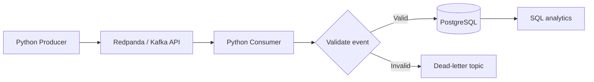

# Real-Time Commerce Streaming Pipeline

A portfolio-grade data engineering project that streams synthetic e-commerce events using Redpanda (Kafka-compatible), Python, and PostgreSQL. It includes event validation, idempotent inserts, a dead-letter topic (DLQ), SQL analytics, Docker Compose, and unit tests.

**Project guide:** [Read the project explanation](docs/project-explanation.md) · [Open the PDF guide](docs/real-time-commerce-streaming-pipeline-explanation.pdf)

> Local demo with synthetic data. Run the Docker integration before describing the entire stack as deployment-tested.

## Architecture



## Stack
Python 3.11 · Redpanda · PostgreSQL 16 · Docker Compose · pytest

## Structure
```text
src/event_schema.py   # Event contract and validation
src/producer.py       # Synthetic Kafka producer
src/consumer.py       # Consumer, DLQ routing, database writes
src/db.py             # Schema and idempotent insert
src/demo.py           # Offline validation demo
tests/                # Unit tests
sql/analytics.sql     # Analytics queries
data/sample_events.jsonl
docs/project-explanation.md
docs/real-time-commerce-streaming-pipeline-explanation.pdf
docker-compose.yml
Dockerfile
```

## Quick start: unit tests

```bash
python -m venv .venv
# Windows PowerShell
.\.venv\Scripts\Activate.ps1
pip install -r requirements.txt
pytest -q
```

## Offline demo (no Docker required)

```bash
python -m src.demo
```

## Full streaming stack

Prerequisites: Docker Desktop/Engine with Compose; 4–6 GB RAM recommended.

```powershell
Copy-Item .env.example .env
docker compose up --build -d
docker compose ps
```

- Redpanda Kafka API: `localhost:9092`
- PostgreSQL: `localhost:5433`
- Redpanda Console: http://localhost:8088

The consumer runs continuously in the Compose service. Publish events using:

```bash
docker compose run --rm consumer python -m src.producer --count 100
```

Invalid events are sent to `commerce-events.dlq`; valid events are inserted into PostgreSQL. Replayed `event_id` values do not create duplicate rows.

## Event contract

Fields: `event_id`, `event_type`, `event_time`, `user_id`, `session_id`, `product_id`, `category`, `quantity`, and `unit_price`. Supported event types include view, add-to-cart, checkout, and purchase. Invalid timestamps, missing fields, unsupported event types, invalid quantities, and negative prices are rejected.

## Analytics

`sql/analytics.sql` contains example queries for purchase revenue, sessions by event type, revenue by category, and daily active users.

## Reliability concepts

- Manual offset commits after processing.
- Idempotent database writes using `event_id` as primary key and `ON CONFLICT DO NOTHING`.
- Dead-letter topic for malformed/unexpected events.
- Consumer group and topic visibility through Redpanda tooling.

## Production extensions

1. Add schema registry with Avro/Protobuf compatibility checks.
2. Add retry/backoff and explicit transient-vs-permanent error handling.
3. Add metrics, alerts, consumer lag monitoring, and structured logs.
4. Add integration tests with a disposable Compose stack.
5. Add secrets management, TLS, and SASL for non-local deployment.
6. Add CI for linting and tests, plus a Metabase/Power BI dashboard.

## GitHub repository description

Real-time e-commerce event streaming with Python, Redpanda/Kafka, PostgreSQL, event validation, idempotent ingestion, Docker, and a dead-letter queue.

Suggested topics: `data-engineering`, `streaming`, `kafka`, `redpanda`, `postgresql`, `python`, `docker`, `event-driven-architecture`.
